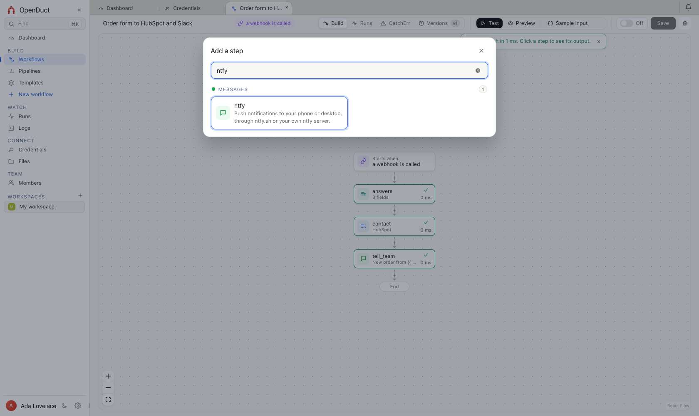
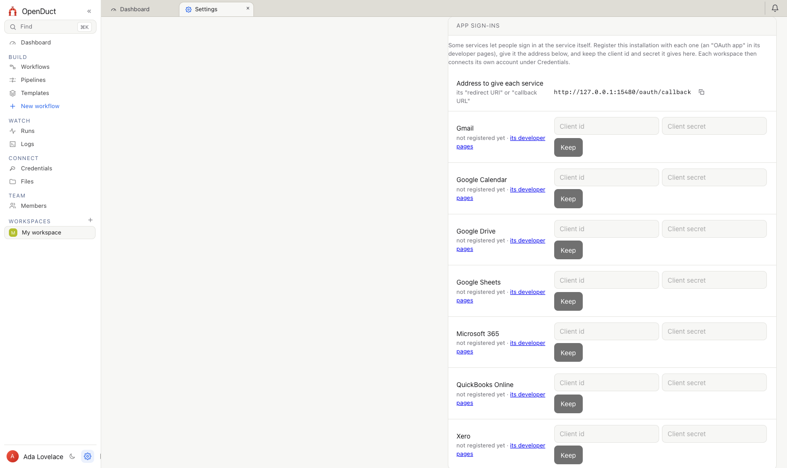

# Building an app

OpenDuct talks to a service through an **app**: a folder with a definition file, a README and recorded tests. The
definition is data, not code, so building one is describing the service's API. This tutorial builds a real one -
**ntfy**, which sends push notifications to your phone - from nothing to a step in the studio. The finished app is in
[`examples/apps/ntfy`](../../examples/apps/ntfy). [docs/apps.md](../apps.md) is the full reference.

## 1. Start it

```sh
openduct app new ntfy --dir examples/apps
```

```text
Made examples/apps/ntfy: change app.yaml to the service's API, then:
  openduct app check examples/apps/ntfy
  openduct app test examples/apps/ntfy
  openduct app try examples/apps/ntfy list_contacts --credential-file my-key.env
```

The folder holds a starting definition, a README and one recorded test, which already pass. Now make them ntfy's.

## 2. Describe the service

ntfy's [publishing API](https://docs.ntfy.sh/publish/) takes a JSON message posted to its address, with an access
token. That is all the definition says:

```yaml
app: ntfy
name: ntfy
category: messaging
description: Push notifications to your phone or desktop, through ntfy.sh or your own ntfy server.
docs: https://docs.ntfy.sh/publish/
hosts: [ntfy.sh]                  # the only host its requests may go to
base_url: https://ntfy.sh
base_url_field: server            # a server of your own, given in the credential, takes ntfy.sh's place
sign_in:
  - id: ntfy                      # the kind of credential it takes
    label: An access token
    fields:
      - { name: token, label: "The access token (tk_...)", secret: true }
      - { name: server, label: "Your own server (ntfy.sh when empty)", optional: true }
    headers:
      Authorization: "Bearer {{ credential.token }}"
error: value.error                # what a refusal says, read from ntfy's answer
default_action: send
actions:
  send:
    label: Send a notification
    write: true                   # it changes something: a test shows it and does not send it
    method: POST
    path: /
    inputs:
      - { name: topic, label: "The topic: the name your phone subscribes to", required: true }
      - { name: message, label: The message, required: true }
      - { name: title, label: A title }
      - { name: priority, label: "1 (least) to 5 (most urgent); 3 when empty", kind: number }
      - { name: click, label: An address to open when it is tapped }
    send:
      topic: "{{ input.topic }}"
      message: "{{ input.message }}"
      title: "{{ input.title }}"
      priority: "{{ input.priority == null ? null : int(input.priority) }}"
      click: "{{ input.click }}"
```

- Each **input** becomes a box in the studio's form, labelled as written here.
- **Templates** (`{{ }}`) and expressions are [CEL](../expressions.md): `input` is the step's inputs, `credential`
  the credential's fields. An input left empty is left out of the body.
- An app that lists things adds `items` and `next` to read page after page; one signed in at the vendor adds
  `oauth2`. Both are in [docs/apps.md](../apps.md#the-definition).

Check it as you go - every name, host, template and expression:

```sh
openduct app check examples/apps/ntfy
```

```text
✓ ntfy (ntfy): 1 action, signs in as ntfy
```

## 3. See the request it makes

`try` shows the request an action makes, with the credential's secrets as `•••`. Put a token in a file only you may
read - never on the command line, never in an environment variable:

```sh
printf 'token=tk_your_token\n' > ntfy.env && chmod 600 ntfy.env
openduct app try examples/apps/ntfy send --credential-file ntfy.env \
  --input topic=shop-orders --input "message=Order A-100 is paid" --input priority=4
```

```text
POST https://ntfy.sh/
  authorization: Bearer •••
  (application/json) {"topic":"shop-orders","message":"Order A-100 is paid","priority":4}
(not sent: add --send to send it)
```

Add `--send` to send it for real, exactly as a workflow step would - tokens fetched and renewed, every page of a
list - and see what came back. Subscribe to the topic in the ntfy app on your phone first.

## 4. Record what it sends and gets back

A recorded test says what the action sends and what the service answered, so the app is tested with no account and
no network - on every change, in CI. Write one for each action and one for a refusal. `tests/send.yaml`:

```yaml
description: A notification with a title and a priority
action: send
credential: { token: tk_example }
input: { topic: shop-orders, message: "Order A-100: 2 x Canvas Tote", title: New order, priority: 4 }
exchanges:
  - sent:
      method: POST
      url: https://ntfy.sh/
      headers: { authorization: Bearer tk_example }
      body: { topic: shop-orders, message: "Order A-100: 2 x Canvas Tote", title: New order, priority: 4 }
    answer:
      body: { id: hwQ2YpKdmg, event: message, topic: shop-orders, title: New order, message: "Order A-100: 2 x Canvas Tote", priority: 4 }
result: { id: hwQ2YpKdmg, event: message, topic: shop-orders, title: New order, message: "Order A-100: 2 x Canvas Tote", priority: 4 }
```

`tests/refused.yaml` - a token ntfy does not know:

```yaml
action: send
credential: { token: tk_wrong }
input: { topic: shop-orders, message: Hi }
exchanges:
  - answer: { status: 401, body: { code: 40101, http: 401, error: unauthorized } }
error: "ntfy answered 401: unauthorized"
```

Take the answers from the service's documentation or from `try --send`, with any real data changed. Then:

```sh
openduct app test examples/apps/ntfy
```

```text
✓ examples/apps/ntfy/tests/own_server.yaml
✓ examples/apps/ntfy/tests/refused.yaml
✓ examples/apps/ntfy/tests/send.yaml
3 passed, 0 failed
```

## 5. Use it in the studio

Start OpenDuct with your apps beside those it comes with:

```sh
openduct start --data-dir ./data --apps-dir examples/apps
```

The app is a step like any other, its form made from the definition:



Add an **ntfy** credential with your token under Credentials, then the step: a topic, and a message such as
`New order {{ value.id }}: {{ value.total }}`. Test it - the request shows, nothing is sent - and turn the workflow on.

## 6. Write its README and share it

The README says what the app does, where to get the credential, which permissions to give it, and what was run
against a live account ([the ntfy README](../../examples/apps/ntfy/README.md)). To add an app to OpenDuct for
everyone, put the folder in `apps/` and open a pull request; it is reviewed against the
[checklist](../apps.md#review-checklist).

## An app people sign in to at the service

For a service where a person signs in at the service itself - Google, Microsoft 365, QuickBooks, Xero - the sign-in
says `oauth2`, and each installation registers with the service once. The installation's admin enters its client id
and secret under **Settings → App sign-ins**, where the address to give the service is shown; each workspace then
presses **Connect** under Credentials. OpenDuct takes no part beyond the installation's own registration.


