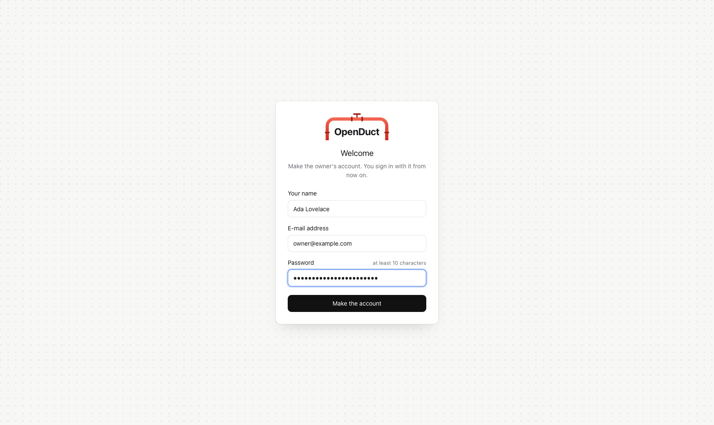
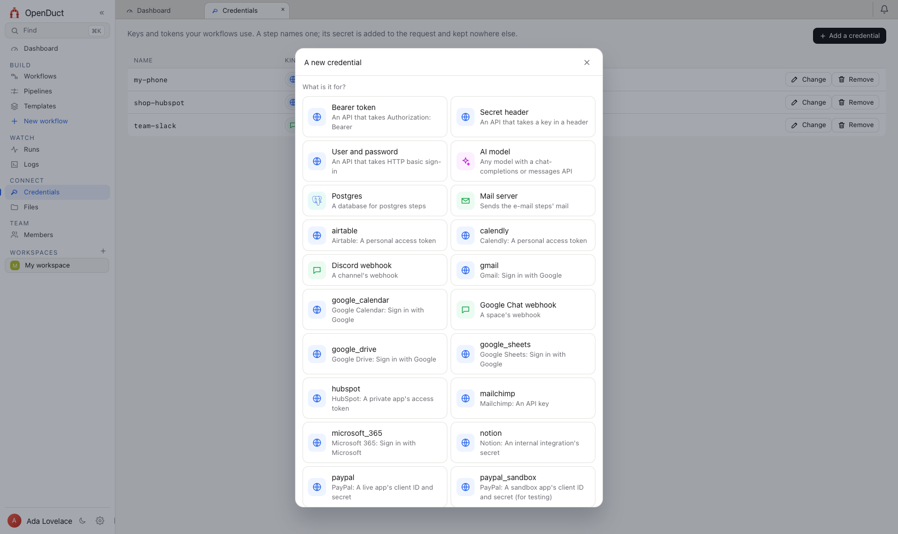
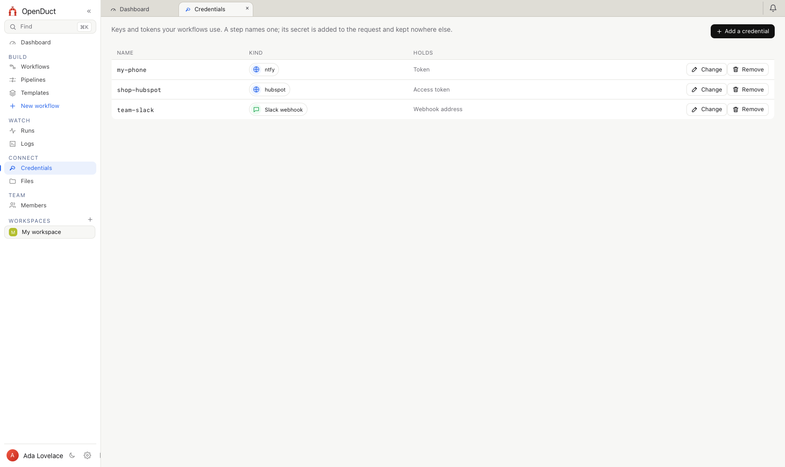
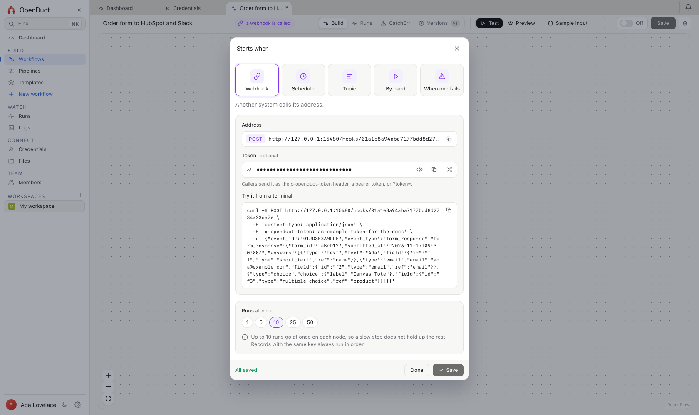
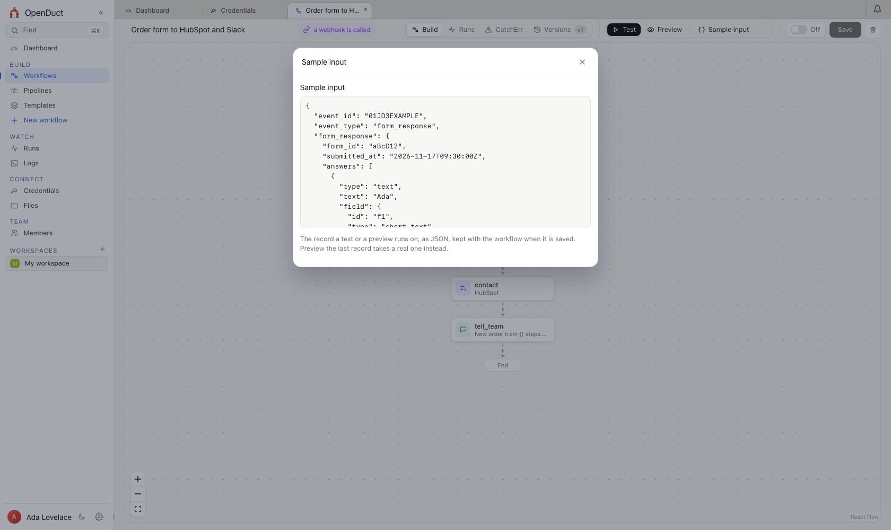
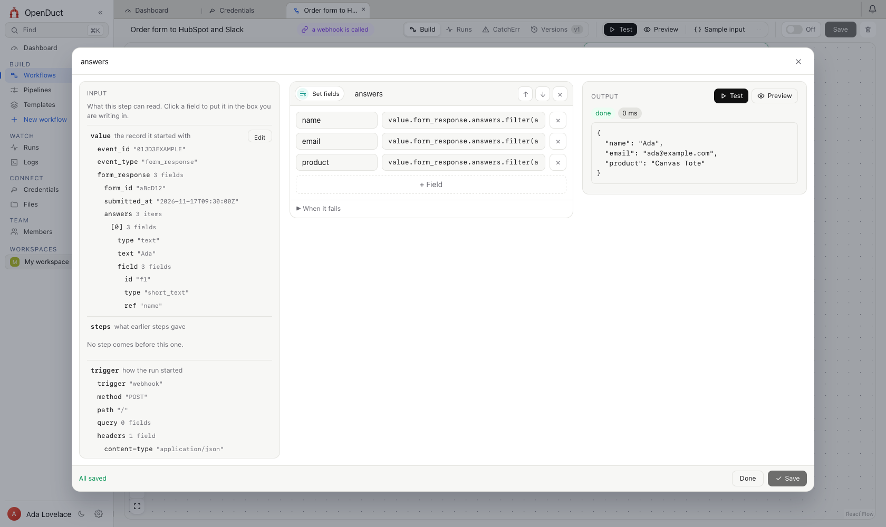
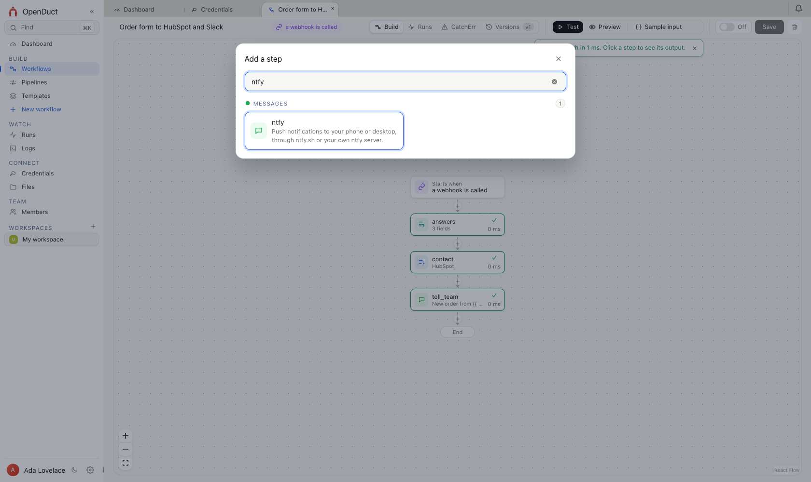
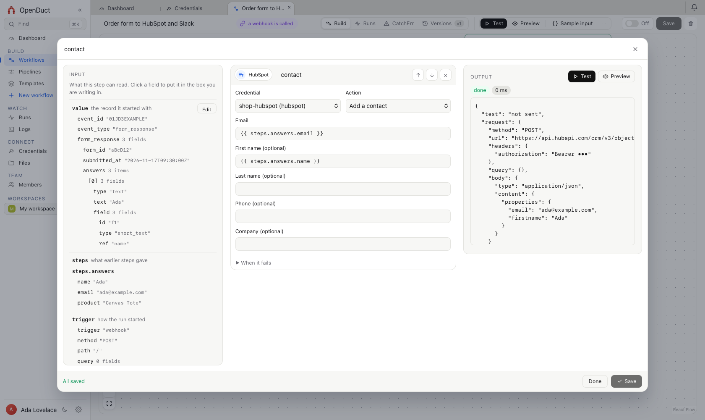
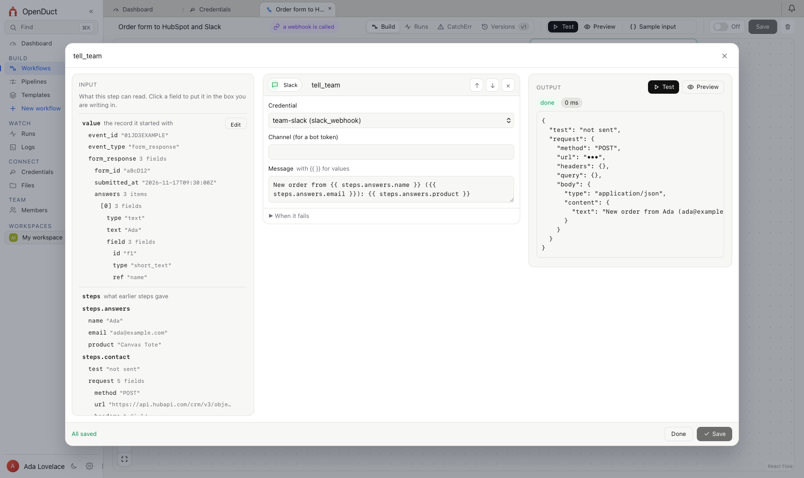
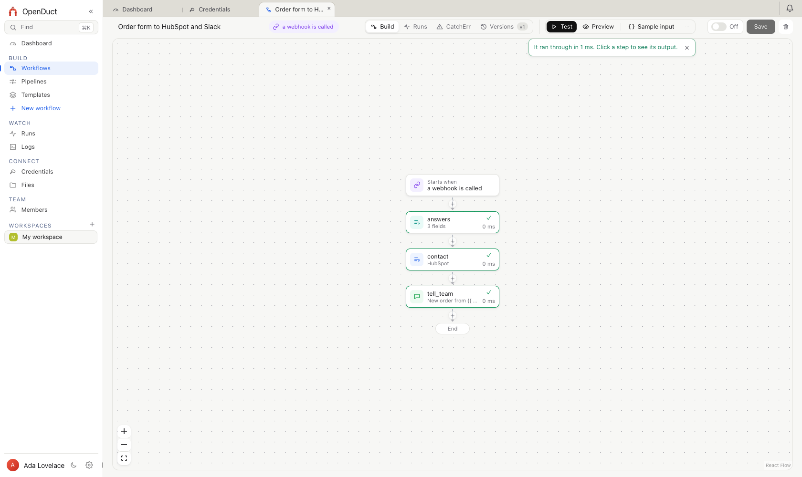

# Your first workflow: an order form to HubSpot and Slack

A customer fills in your order form on Typeform. You want them in HubSpot as a contact, and your team told in Slack,
without copying anything by hand. This tutorial builds that workflow in the studio in about fifteen minutes, and
tries it before anything is sent.

You need OpenDuct, a HubSpot account and a Slack workspace. The form can be Typeform or any other form tool
([forms](forms.md) shows several).

## 1. Start OpenDuct and make your account

```sh
openduct start --data-dir ./data
```

Open the address it prints (`http://127.0.0.1:5480`). The first visit makes the owner's account:



## 2. Add the two credentials

A credential holds what a step needs to reach a service. It is sealed when it is kept, and never shown back.

- **HubSpot**: in HubSpot, **Settings → Integrations → Private Apps → Create a private app**, with the scopes
  `crm.objects.contacts.read` and `crm.objects.contacts.write`. Copy its access token.
- **Slack**: in Slack, add an **Incoming Webhook** to the channel the team reads, and copy its address.

In the studio, **Credentials → Add a credential**, choose the kind, give it a name your steps will use, and paste the
token or address:



Here they are called `shop-hubspot` and `team-slack`:



## 3. Make the workflow and choose its trigger

**New workflow**, and name it. Click **Starts when** and choose **Webhook**: the form will call the workflow's
address each time it is answered. Give it a token, so only your form can.



The address is the workflow's own, made at random. The token can go in a header, as a bearer token, or as
`?token=` on the address - the last is what a form tool takes. [Triggers](triggers.md) covers the other ways a
workflow can start.

## 4. Give it a sample answer

Tests run on a **sample input**: what the trigger will deliver. Click **Sample input** and paste an answer as
Typeform sends it - here a name, an e-mail address and the product chosen:



The easiest way to get a real one: turn the workflow on, answer your form once, and copy the event from **Runs**.
The sample is kept with the workflow when you save it.

## 5. Pick the answers out

Typeform sends the answers as a list, each with the `ref` you gave its question. Add a **Set fields** step called
`answers`, with one field for each answer you need:

| Field | Expression |
|---|---|
| `name` | `value.form_response.answers.filter(a, a.field.ref == 'name')[0].text` |
| `email` | `value.form_response.answers.filter(a, a.field.ref == 'email')[0].email` |
| `product` | `value.form_response.answers.filter(a, a.field.ref == 'product')[0].choice.label` |

The step's window shows its **Input** on the left - the sample, field by field - its settings in the middle, and its
**Output** on the right after a test. Click a field on the left to put it into the box you are writing in.



## 6. Add the contact to HubSpot

Click **+** under the step, search for the app, and choose it:



Choose **HubSpot**, the credential `shop-hubspot`, and the action **Add a contact**. Its inputs come from the app's
own definition: put `{{ steps.answers.email }}` in Email and `{{ steps.answers.name }}` in First name - or click
`email` and `name` under `steps.answers` on the left.



## 7. Tell the team in Slack

Add a **Slack** step with the credential `team-slack`, and a message:

```text
New order from {{ steps.answers.name }} ({{ steps.answers.email }}): {{ steps.answers.product }}
```



## 8. Test it

Press **Test**. The whole workflow runs on the sample, and **nothing is sent**: each app step shows the request it
would make, with the credential's secret as `•••`. Each step is marked done, failed, or not reached:



Click a step to see what it gave. When the requests look right, **Preview** does the reads for real and still only
shows the writes. Then **Save**, and turn the workflow **On**.

## 9. Connect the form

In Typeform, **Connect → Webhooks → Add a webhook**, and paste the workflow's address with `?token=` and its token
added. Typeform's **Send test request** sends a sample answer: it appears under **Runs** at once.

The studio must be reachable from the internet for that - behind HTTPS, with `--studio-host` naming it: see
[deployment](../deployment.md#the-studio-and-workflows-in-a-cluster).

## 10. Watch it run

- **Runs** shows each answer's run, step by step, with what each step gave.
- If HubSpot or Slack refuses or does not answer, the step is tried again (set under *When it fails*), then the
  answer is kept in **CatchErr**, to run again once the cause is fixed. Nothing is lost.
- Several answers run at once - up to 10 unless you choose otherwise, under the trigger's *Runs at once*.

## The workflow as a file

The studio keeps the workflow as YAML; `openduct workflow check` and `openduct workflow test` read the same file.

```yaml
name: Order form to HubSpot and Slack
trigger:
  webhook: { token: your-own-token }
steps:
  - name: answers
    set:
      name: "value.form_response.answers.filter(a, a.field.ref == 'name')[0].text"
      email: "value.form_response.answers.filter(a, a.field.ref == 'email')[0].email"
      product: "value.form_response.answers.filter(a, a.field.ref == 'product')[0].choice.label"
  - name: contact
    hubspot: { action: create_contact, credential: shop-hubspot, email: "{{ steps.answers.email }}", firstname: "{{ steps.answers.name }}" }
  - name: tell_team
    slack: { credential: team-slack, text: "New order from {{ steps.answers.name }} ({{ steps.answers.email }}): {{ steps.answers.product }}" }
```

Next: [the other triggers](triggers.md), [other forms](forms.md), and [building an app](build-an-app.md) for a
service OpenDuct does not have yet.
