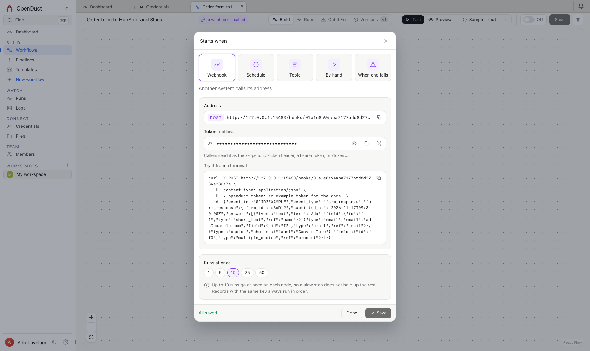

# Creating triggers

A workflow's trigger decides when it runs. Click **Starts when** at the top of the canvas and choose one of five:



Whatever the trigger, the run reads what started it as `value`, and how it started as `trigger`. Give each workflow
a **sample input** shaped like what its trigger delivers, so a test runs on something real (the templates come with
one).

## Webhook: another system calls its address

For forms, payment providers, shops, and anything that can call an address when something happens.

1. Choose **Webhook**. The window shows the workflow's address: random, its own, and the same once saved.
2. Give it a **token** (the shuffle button makes one), so only those who have it can call. A caller sends it in the
   `x-openduct-token` header, as a bearer token (`Authorization: Bearer ...`), or as `?token=` on the address -
   whichever the other system can do. Telegram's own secret header is taken too.
3. Copy the **curl** command and run it in a terminal: it sends the workflow's sample input, and the run appears
   under **Runs**.

```sh
curl -X POST https://flows.example.com/hooks/01a1e8a94aba7177bdd8d2734a236a7e \
  -H 'content-type: application/json' \
  -H 'x-openduct-token: your-own-token' \
  -d '{"id": "A-100", "total": 120}'
```

- **What it reads:** a JSON body as it is; a form (`application/x-www-form-urlencoded` or `multipart/form-data`)
  field by field, a file by its name; anything else as text.
- **`trigger`** holds the method, the path after the address, the query, the headers (sign-in headers and cookies
  left out) and the time.
- **The answer:** the delivery is kept on the workflow's topic before it is answered `202`, so nothing is lost even
  if a step is slow. To answer with something of your own - a JSON result, a thank-you page, a redirect - add a
  **Respond to webhook** step: its status, headers and body are what the caller gets.

## Schedule: every so often

For reports, checks and anything to do at regular times.

1. Choose **Schedule**, and how often: `30s`, `15m`, `1h`, `1d`, or any number with `s`, `m`, `h` or `d`.
2. Times are counted from midnight UTC: every `15m` runs at :00, :15, :30 and :45; every `1d` at midnight UTC.

- **`value`** is `{ "scheduled_at": "2026-11-17T09:00:00Z" }` - the time it was due, so a run can ask for "the day
  before" with `timestamp(value.scheduled_at) - duration('24h')`.
- **In a cluster** each time runs once, on one node, and goes on while any node is up.

## Schedule: at set times

For the morning report, the Monday summary, the invoice run on the 1st.

1. Choose **Schedule**, then how often: **Every hour** (at a minute past it), **Every day**, **Weekdays** (Monday to
   Friday), **Weekly** (on the days you choose) or **Monthly** (on the dates you choose, or the last day), and the
   time - or several times.
2. Choose the **time zone** the times are in: UTC unless you choose, or *Use mine* for your browser's.
3. **Next runs** shows the next five times, on that clock, as you change them - or what is wrong, in plain words.

The same in a workflow file:

```yaml
trigger:
  schedule:
    every: week            # hour, day, weekday, week or month
    on: [monday, thursday] # week: days; month: dates (1 to 31) or last
    at: "08:30"            # or a list: ["08:30", "17:00"]; 9am and 5:30 pm work too
    timezone: Europe/Berlin
```

**Cron**, for anything else: five fields - minute, hour, day of the month, month, day of the week - or six with the
second first. `0 9 * * 1-5` is 09:00 on weekdays, `*/10 * * * *` every ten minutes, `0 0 L * *` midnight on each
month's last day; `@daily` and `@hourly` work too. `cron:` takes a list as well, and `timezone:` as above.

- **Clock changes:** a time the clock skips when it goes forward (02:30 on that night) runs once, as the clock jumps;
  a time it passes twice when it goes back runs once, the first time. So a daily schedule runs once every day, and an
  hourly one once for each hour the clock shows. `every: 15m` keeps to real time in every zone.
- A month without the date chosen (the 31st in April) is passed over; choose **Last day** for every month's.
- `openduct workflow check` prints when a schedule runs next.

## Topic: each message of a topic

For events your own programs write with any Kafka client, or other workflows write with a **Write to a topic** step.

1. Choose **Topic**, and name it: `orders`.
2. Choose where a new workflow starts: **latest** (only messages from now on, the default) or **earliest** (every
   message the topic still holds).

- **`value`** is the message (its JSON, or its text); **`trigger`** holds the topic, partition, offset and key.
- **Order:** messages with the same key run one after another, in order; others run several at once (up to
  *Runs at once*, 10 unless you choose).
- **From outside OpenDuct**, a workspace's topic has a longer name, so two workspaces never share one: Settings shows
  it (`w.<workspace>.orders`). Inside the studio it is just `orders`.

```sh
openduct send w.01a1e8a9-44e0-70ba-b1e6-c0267f1c72a3.orders '{"id": "A-100", "total": 76}' --key A-100
```

## By hand: someone presses Run

For jobs run now and then - a clean-up, a report on request. **Run for real** (in the menu beside Test) runs the
sample input as a real event; turn the workflow on first.

## When one fails: another workflow's failed runs

For telling someone, or putting things right, when a workflow fails at its last try.

1. Choose **When one fails**, and the workflow to watch.

- **`value`** is the record the failed run started with; **`trigger`** holds the workflow, the run, the error and
  how the failed run had started (`original`).
- The failed record is in that workflow's **CatchErr** as well, to run again once the cause is fixed.

## How many at once

Every trigger's window ends with **Runs at once**: up to that many runs go at the same time on each node (1 to 50),
so a slow step does not hold up the rest. With **1**, each event runs after the one before. Events with the same key
always run in order.
